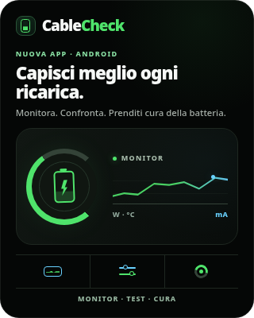
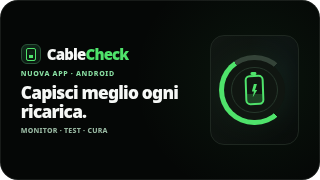
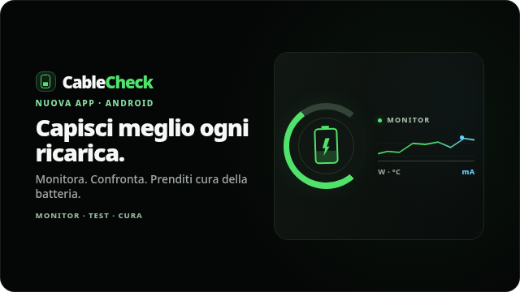

# CableCheck — Annuncio lancio | revisione creativa v3 HTML/CSS

> **RIFINITURA v3 — 1 novembre 2026.** La proposta con grande indicatore «W», barre decorative e glow uniforme è stata scartata dall'owner: troppo generica e poco fedele a CableCheck. La nuova variante prende come riferimenti BatteryLevelGauge, ChargeArcGauge, MonitorHeroAccent, CareScoreRing e docs/design-system.md. Gli screenshot allegati sono render Chromium degli stessi template HTML/CSS v2.
>
> **Collaudo pre-lancio è consentito**, anche se la scheda Play non è pubblica. Non annunciare falsa disponibilità pubblica né aggiungere CTA Store non verificate. Questa PR resta Draft, niente Produzione/FCM.

**Stato:** CREATIVITÀ v3 APPROVATA PER PROVA IN COLLAUDO — NON ANCORA DISTRIBUITA, NO PRODUZIONE/FCM  
**Data:** 2026-11-01  
**Campaign ID:** `2026-11-01-cablecheck-launch`  
**Owner:** Developer Profile / AppCommunications  
**Materiale:** `content/campaigns/2026-11-01-cablecheck-launch.json`  
**Fonte delle regole:** [Playbook multiprodotto](https://github.com/Lucrezio0987-Org/AppCommunications/blob/main/docs/EDITORIAL-CAMPAIGN-PLAYBOOK.md).

> **DECISIONE DI COLLAUDO (01/11/2026):** l'utente autorizza a procedere con la v3 in ambiente Collaudo anche prima della disponibilità pubblica della versione sul Play Store. Il file sorgente è stato posto a `status:published` nel branch della PR esclusivamente per consentire l'output del publisher dopo i controlli. Non è un'autorizzazione a notifiche push, Produzione o messaggi «scarica ora».

## Premessa / stop sul claim di disponibilità

- Il catalogo [`content/catalog/apps.json`](../../../content/catalog/apps.json) riporta **`storePublished: false`** per `cablecheck`; perciò **non possiamo annunciare che è scaricabile ora** senza conferma ufficiale.
- `CableCheck/package.json` su `main` riporta **0.16.0**, ma quella è versione del sorgente, **non** una prova che Google Play l'abbia distribuita.
- La build [CableCheck Collaudo #41327878501](https://github.com/Lucrezio0987-Org/CableCheck/actions/runs/41327878501) è APK di prova distinto dal pacchetto `com.lucrezio0987.cablecheck`; non implica pubblicazione su Play.
- **Niente FCM, Produzione, campagna live o CTA Play prima del gate.** Non inventare data, review, prezzo, download e stato Play.

## Audit del vero prodotto

| Elemento | Fonte canonica | Scelta |
| --- | --- | --- |
| Palette dark | [`src/view/theme/tokens.ts`](https://github.com/Lucrezio0987-Org/CableCheck/blob/main/src/view/theme/tokens.ts) | `#050706` background, `#0A0D0B` surface, `#111713` raised, `#4FE36B` green positive, `#69D2FF` info, `#1E2720` border, `#F6F8F6` text, `#A4ACA6` muted |
| Regole UI | [`docs/design-system.md`](https://github.com/Lucrezio0987-Org/CableCheck/blob/main/docs/design-system.md) | Tool tecnico, dati leggibili, pochi box, una CTA, verde energia / azzurro informazione, niente grafica stock |
| Cerchio batteria | [`BatteryLevelGauge.tsx`](https://github.com/Lucrezio0987-Org/CableCheck/blob/main/src/view/components/monitor/BatteryLevelGauge.tsx) e [`ChargeArcGauge.tsx`](https://github.com/Lucrezio0987-Org/CableCheck/blob/main/src/view/components/charging/ChargeArcGauge.tsx) | Ring CSS illustrativo, non fotografia né misurazione reale |
| Stato e traccia | [`MonitorHeroAccent.tsx`](https://github.com/Lucrezio0987-Org/CableCheck/blob/main/src/view/components/monitor/MonitorHeroAccent.tsx) | Accento energetico organico, linea sottile e visualizzazione stilizzata |
| Cura | [`CareScoreRing.tsx`](https://github.com/Lucrezio0987-Org/CableCheck/blob/main/src/view/components/care/CareScoreRing.tsx) e [`CareSectionBackdrop.tsx`](https://github.com/Lucrezio0987-Org/CableCheck/blob/main/src/view/components/care/CareSectionBackdrop.tsx) | Indicatore circolare, glow discreto e colori legati al significato |
| Confronti | [`ChargingComparisonPanel.tsx`](https://github.com/Lucrezio0987-Org/CableCheck/blob/main/src/view/components/charging/ChargingComparisonPanel.tsx) | Confronti disponibili ma condizionati ai dati e alla comparabilità |
| Identità app | [`assets/icon.png`](https://github.com/Lucrezio0987-Org/CableCheck/blob/main/assets/icon.png) | Il **marchio in CSS è una stilizzazione editoriale**, non pixel-identico all'icona installata; non dichiararlo screenshot originale |

## Creative direction v3: fedeltà al design system di CableCheck

**Headline:** «Capisci meglio ogni ricarica.» (in sei lingue). **Supporting line:** «Monitora. Confronta. Prenditi cura della batteria.».

- **Poster 4:5:** wordmark, eyebrow, headline e deck in cima; una superficie principale con **arco a 260°** come ChargeArcGauge, sagoma batteria e unico andamento sottile in verde/azzurro come MonitorHeroAccent; in basso una striscia leggera a tre icone Monitor/Test/Cura, senza tre nuove card. Sfrutta tutta l'altezza del poster senza vuoti strutturali.
- **Banner inbox 16:9:** composizione più compatta; testo localizzato a sinistra e piccolo indicatore circolare a destra, headline comprensibile anche a **320×180**, footer con le tre aree prodotto. Niente CTA né deck lungo dentro la miniatura: l'intera card resta tappabile nel client.
- **Landscape/inline:** layout davvero distinto, più spazioso: testo completo e footer a sinistra, gauge a 260° e micro-traccia Monitor sulla superficie di destra, senza simulare misurazioni reali.
- **Colori reali:** background #050706, surfaceRaised #111713, verde energia #4FE36B, azzurro informativo #69D2FF. Il design system richiede **meno box**, glow minimo, griglia discreta e colori semantici.
- **Niente valori fittizi:** gli archi sono **senza percentuali e senza punteggi**, il grafico è una traiettoria illustrativa senza scala numerica; W/°C/mA sono **solo unità**, mai dati misurati. L'arco parziale non indica una reale percentuale di carica.
- **Fedeltà dichiarata:** il logomark batteria CSS è stilizzato, non la bitmap del launcher; i componenti raffigurati non sono screenshot reali.
- **Contratto:** tre template HTML/CSS statici con placeholder tradotti, nessuna risorsa remota, JS, SVG, img o CTA arbitraria. Le immagini PNG nel dossier sono **screenshot di revisione**, non immagini distribuite nel feed.

### Cambiamenti grafici verificati nella rifinitura v3

- Arco della ricarica ripreso dalla geometria del vero `ChargeArcGauge` (inizio 140°, sweep 260°); il segmento colorato non è un livello percentuale reale.
- Simbolo batteria con terminale e lightning minimale in CSS, in luogo del precedente fulmine isolato; è una **stilizzazione del tema**, non l'icona ufficiale e non uno screenshot dell'app.
- Traccia energia sottile a contrasto ridotto con un solo marker informativo azzurro: richiama il linguaggio del `MonitorHeroAccent` ed elimina le barre fittizie.
- Tre piccoli simboli CSS distinti (monitor, confronto, cura) separati da **linee**, non da card piene; i titoli sono localizzati tramite il campo `footer`.
- Banner Novità composto separatamente: niente descrizione lunga nella card 320×180, ma il testo resta disponibile nel poster e nel corpo della campagna.
- CSS statico senza riferimenti esterni, JS, SVG o HTML attivo; nessuna CTA perché è ancora una bozza pre-lancio senza URL Store verificato.
- Nessuna modifica a ID, `revision:1`, `status:draft`, ambiente `collaudo`, audience o sei traduzioni. Nessun merge/pubblicazione autorizzato dalla sola rifinitura.

## Anteprime del sorgente della campagna

| Poster 4:5, 320×400 | Banner inbox 16:9, 320×180 |
| --- | --- |
|  |  |

Le immagini sono **screenshot Chromium dello stesso HTML/CSS** incorporato nella campagna, non asset scaricati dallo Store né figure AI. Il client finale renderizza HTML/CSS compilato dal publisher.

## Contratto e distribuzione — stato attuale

| Campo | Valore |
| --- | --- |
| `status` | `published` **nel solo branch di staging** per consentire compilazione/validazione; pubblicazione reale soltanto dopo merge e Action autorizzata |
| `revision` | `1` |
| `audiences` | `["product.cablecheck"]` per primo preview client |
| `environments` | `["collaudo"]` |
| `placements` | `launch_modal`, `inbox`, `inline_promo` |
| `prioritySchedule` | `low`, quindi nessun popup automatico |
| `notification` | copy in sei lingue già preparato, **nessun invio** |
| `actions` | `[]`, nessuna CTA inattiva o link Play che porta a pagina non disponibile |
| `action` | `none` |

La campagna è stata autorizzata dall'utente per **prova Collaudo**, quindi nel branch di staging `status:published` consente la compilazione. **Finché la PR non viene integrata e il publisher non completa la build, il feed remoto resta invariato**. Non sostituire l'approvazione Collaudo con un'autorizzazione Produzione/FCM.

### Gate indipendenti: Collaudo / Lancio pubblico

**Collaudo pre-lancio:** dopo review grafica e test del contratto è possibile integrare la campagna senza alcuna disponibilità sul Play Store, mantenendo status draft fino all'approvazione. Pubblicare soltanto in Collaudo mediante workflow con SHA approvato. Verificare il vero APK e il rendering in Novità. Niente FCM.

**Produzione e CTA pubblica:** quando l'app sarà effettivamente disponibile e confermata, verificare la pagina Store, aggiungere azione dichiarativa open_store(cablecheck) nel solo poster/landscape, aggiornare copy e QA e chiedere autorizzazione separata per Produzione o FCM. Non inferire autorizzazioni da una PR approvata per Collaudo.

## QA già eseguito / residuo

- [x] Sorgenti CableCheck consultati (tema, componenti, README, note release e catalogo Store).
- [x] Tre template distinti 4:5/16:9, senza CTA duplicate o dati fittizi.
- [x] Copy e notifica IT/EN/ES/FR/DE/PT.
- [x] QA **Chromium di 30 combinazioni**: 6 lingue × (poster 320×400 e 500×625, inbox 320×180 e 500×281, landscape 640×360). Nessun elemento fondamentale fuori viewport e nessuno scroll orizzontale/verticale. Screenshot IT aggiornati in PR; verificati anche personalmente DE e FR a 320px.
- [x] Limite di lunghezza template e policy HTML statico verificati localmente.
- [x] Approvazione owner della direzione v3 e autorizzazione alla prova in Collaudo (messaggio «procedi pure» del 01/11/2026).
- [ ] Verifica Play e CTA Store **solo per la futura comunicazione pubblica**, non necessaria al test Collaudo.
- [ ] Qualificazione del publisher con il commit editoriale approvato, verifica del nuovo feed v2 IT/EN/ES/FR/DE/PT e controllo assenza in Produzione.
- [ ] Smoke Android su CableCheck Collaudo e azione eventuale.
- [ ] Dopo merge e Action, smoke nella WebView CableCheck Collaudo per banner, poster, chiusura, localizzazione e aggiornamento della cache. Produzione/FCM separati.

**Questa è una creatività di pre-lancio per Collaudo, senza affermazioni di disponibilità su Play Store.**
