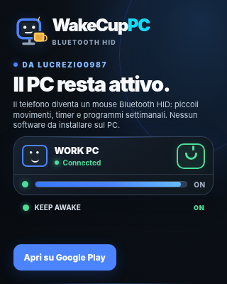
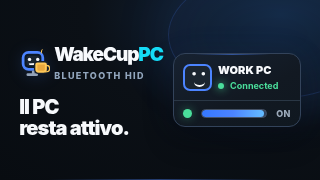

# WakeCupPC r4 — Creatività HTML/CSS (alternativa ufficiale alla r4 raster)

**Stato: BOZZA PER REVISIONE VISIVA; NON PUBBLICARE AUTOMATICAMENTE**  
**Decisione:** 1 novembre 2026 — preferire HTML/CSS responsive al montaggio di immagini della campagna.

## Motivazione

Il proprietario ha respinto entrambe le creatività raster r3 e la proposta r4 fotografica. La PR raster [#11](https://github.com/Lucrezio0987-Org/AppCommunications-Content-/pull/11) è stata **chiusa senza merge**. Una grafica generica costruita con immagini, anche se blu, non rappresenta l'identità dell'app. La preferenza aggiornata è una creatività Web statica che adotti il linguaggio grafico e gli elementi funzionali reali di WakeCupPC.

## Fonti di prodotto effettivamente controllate

- [Repo WakeCupPC](https://github.com/lucrezio0987/HIDAutoInput2) — source of truth.
- [UI DeviceCard](https://github.com/lucrezio0987/HIDAutoInput2/blob/studio/wakecuppc-promo/src/view/components/DeviceCard.component.tsx) — device status, azione e KeepAwakeAura.
- [UI KeepAwakeToggle](https://github.com/lucrezio0987/HIDAutoInput2/blob/studio/wakecuppc-promo/src/view/components/KeepAwakeToggle.component.tsx) — outline della tile, iconografia e stato running.
- [Tutorial attività](https://github.com/lucrezio0987/HIDAutoInput2/blob/studio/wakecuppc-promo/assets/tutorial/tutorial-jiggler-on.svg) — PC, stato attivo e progress bar che si rinnova.
- [ReelPhone/Remotion](https://github.com/lucrezio0987/HIDAutoInput2/blob/studio/wakecuppc-promo/promo-video/src/ReelPhone.tsx) — palette applicativa reale: `#0B1016` canvas, `#121922` surface, `#4C84FF` blue, `#4ADE9B` active, `#15DBF7` cyan.
- [Store Listing](https://github.com/lucrezio0987/HIDAutoInput2/blob/studio/wakecuppc-promo/docs/STORE_LISTING.md) — Keep Awake come valore principale, HID e timer/schedule, nessuna promessa su PC spenti o policy aziendali.

Questa composizione **non è uno screenshot originale** e non deve essere presentata come tale: è una *rappresentazione HTML/CSS editoriale* del design dell'app, ispirata ai componenti reali. La mascotte/icona ricostruita in CSS è una stilizzazione, non una copia pixel-perfect dell'icona launcher.

## Due placement, due layout specifici

**Poster 4:5:** top brand con monitor sorridente e tazzina CSS, headline e deck dal feed localizzato, dispositivo in stato connesso con tile di attivazione, barra attività e **unica CTA** `{{cta:primary}}` gestita dall'host.

**Inbox 16:9:** wordmark WakeCupPC + headline localizzata a sinistra, miniature del dispositivo e dell'attività a destra. Niente CTA nel banner perché l'intera card apre la modale.

**Landscape 16:9:** simile al banner, con la sola CTA autorizzata dall'host.

Le tre varianti condividono token, palette, CSS e semantica di `DeviceCard`, `KeepAwakeToggle`, `tutorial-jiggler-on.svg`. Sono HTML/CSS statico (`<style>`, `<section>`, `
`), con una animazione CSS della barra soggetta a `prefers-reduced-motion`. Nessun file immagine, `url(...)`, JS, SVG, link esterno arbitrario o WebView permissiva.

## Screenshot di revisione (Chromium, 320 px di larghezza)

| Poster 4:5 | Banner 16:9 |
| --- | --- |
|  |  |

Sono screenshot dello **stesso HTML/CSS** usato nel sorgente, renderizzato in Chromium alle proporzioni di destinazione, non fotografie inventate. La visualizzazione Android definitiva deve essere controllata a parte.

## Verifiche già svolte

- [x] Entrambe le varianti renderizzate alle dimensioni 320×400 e 320×180, oltre che a 480×600 e 640×360.
- [x] Verifica layout IT/EN/ES/FR/DE/PT in Chromium a 320px: nessun elemento semantico (titolo, testo, card, CTA) fuori dai limiti.
- [x] CTA presente solo in poster e landscape; inbox senza pulsanti.
- [x] Nessuna immagine remota, nessun JS, nessun CSS `url`, nessun tag `svg` o `img`, nessun `a` arbitrario nei sorgenti.
- [x] `creativeMedia` assente: motore v2 usa correttamente il renderer HTML legacy; non richiede aggiornare l'APK.
- [x] ID, audience CableCheck, 6 lingue, priorità low, Play Store attribution e Collaudo invariati.

## Decisioni prima del rilascio

- [ ] Revisione visuale del proprietario su poster e banner — non trattare questo documento come approvazione implicita.
- [ ] Verifica AppCommunications publisher v2 sul source della PR e feed Collaudo/Produzione.
- [ ] Prova su CableCheck Collaudo installato: zoom e layout, modalità modale/Novità, CTA Google Play, segnalazioni WebView e fallback.
- [ ] Solo dopo review/CI, fare merge nel catalogo principale e lanciare un **nuovo run da main** del publisher. Confermare `published` revision 4 solo Collaudo, `production` invariata. Nessun FCM.

**Campagna r2:** resta in `Content-/main` e `Content-/published`. La r4 di questa PR ha `status:published` unicamente sul branch Draft per consentire eventuali test in isolamento; non è distribuita.
